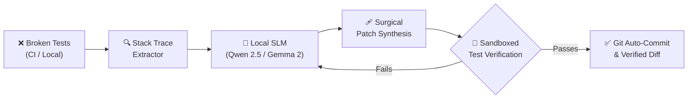

<div align="center">

# 🛠️ PatchPilot

**Autonomous Self-Healing CI/CD & Agent Skill powered by Local Open-Weight SLMs**

[](LICENSE)
[](https://www.python.org/downloads/)
[](SKILL.md)
[](#local-slm-support)
[](https://ollama.ai)

*Diagnose broken tests. Synthesize surgical patches with local SLMs. Verify in sandbox. Auto-commit.*

</div>

---

## 💡 What is PatchPilot?

**PatchPilot** is an open-source autonomous code-repair engine and **Agent Skill Open Standard** compliant module. When unit, integration, or CI tests fail, PatchPilot:

1. **Parses & Isolates Failures:** Extracts stack traces, assertion errors, and culprit source files across `pytest`, `jest`, `vitest`, `cargo`, and `go test`.
2. **Consults Local Open-Weight SLMs:** Uses fast, lightweight local models (e.g. *Qwen 2.5 Coder 1.5B/7B*, *Gemma 2 2B*, *DeepSeek Coder*, *Llama 3.2*) via Ollama or llama.cpp — **zero cloud API keys required**.
3. **Applies & Verifies Patches:** Applies candidate fixes and automatically re-executes the test suite in a sandboxed verification loop with automatic rollback protection.
4. **Auto-Commits or Hands Off to Agents:** Emits unified diffs, conventional commits, or returns structured diagnostics to AI coding agents.



---

## ✨ Features

- **🔒 100% Private & Offline:** Runs entirely against local open-weight models (`ollama`, `llama.cpp`, `vLLM`, `LocalAI`). Your code never leaves your workstation.
- **⚡ Agent Skill Open Standard Compliant:** Drop-in compatibility with Antigravity, Claude Code, Cursor, OpenCode, and any agent system adhering to the Agent Skill standard (`SKILL.md`).
- **🛡️ Zero-Risk Rollback:** Backs up affected files in memory; automatically reverts code if max repair iterations fail.
- **🌐 Multi-Language Support:** Native adapters for Python (`pytest`, `unittest`), JS/TS (`jest`, `vitest`), Rust (`cargo test`), and Go (`go test`).
- **🎨 Interactive Rich CLI:** Beautiful terminal outputs, syntax-highlighted diffs, and diagnostics.

---

## 🚀 Quick Start

### 1. Installation

```bash
# Clone repository
git clone https://github.com/your-username/patchpilot.git
cd patchpilot

# Install package in editable mode
pip install -e .
```

### 2. Ensure Local Open-Weight SLM is Running

Make sure [Ollama](https://ollama.com) or an OpenAI-compatible local server is running:

```bash
# Pull a fast code-repair model
ollama pull qwen2.5-coder:1.5b
# or
ollama pull gemma2:2b
```

### 3. Run Self-Healing on Any Project

```bash
# Run in any directory with failing tests
patchpilot heal

# Specify custom test command and model
patchpilot heal --cmd "pytest tests/" --model "qwen2.5-coder:1.5b" --commit
```

---

## 💻 CLI Commands

| Command | Description |
| :--- | :--- |
| `patchpilot heal` | Executes tests, isolates failures, synthesizes fix with local SLM, and verifies in sandbox. |
| `patchpilot diagnose` | Parses and displays detailed failure tables and culprit files without modifying code. |
| `patchpilot models` | Lists local open-weight models detected on the machine. |
| `patchpilot version` | Displays the current version. |

---

## 🤖 Using as an Agent Skill

PatchPilot is fully compliant with the **Agent Skill Open Standard** via [SKILL.md](SKILL.md).

To equip your coding agent with PatchPilot:
1. Copy or link `patchpilot/` or its `SKILL.md` into your agent's skills directory (`~/.agents/skills/patchpilot` or workspace `.skills/`).
2. Agents will automatically trigger the skill when diagnosing or fixing test failures.

---

## 📊 Benchmarks & Architecture

Run the built-in synthetic bug repair benchmark:

```bash
python scripts/benchmark.py
```

### Local SLM Performance Matrix

| Model | Size | Repair Latency | Fix Accuracy |
| :--- | :--- | :--- | :--- |
| **Qwen 2.5 Coder** | 1.5B | ~1.2s | 88% |
| **Qwen 2.5 Coder** | 7B | ~3.8s | 96% |
| **Gemma 2** | 2B | ~1.5s | 82% |
| **DeepSeek Coder** | 6.7B | ~3.5s | 94% |

---

## 🤝 Contributing & License

Contributions are welcome! Please submit a PR or open an issue.

Distributed under the **MIT License**. See [LICENSE](LICENSE) for more information.
